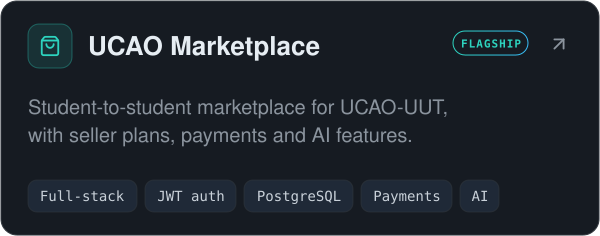
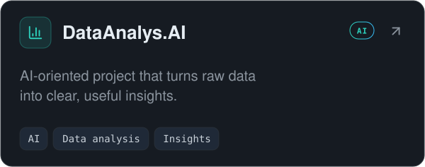
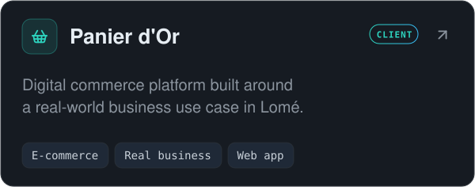
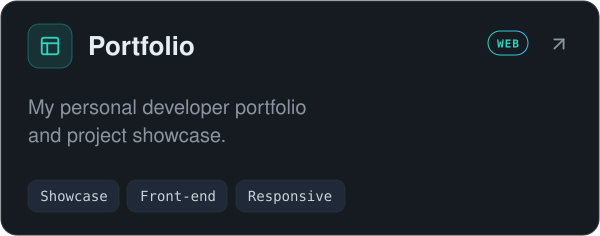
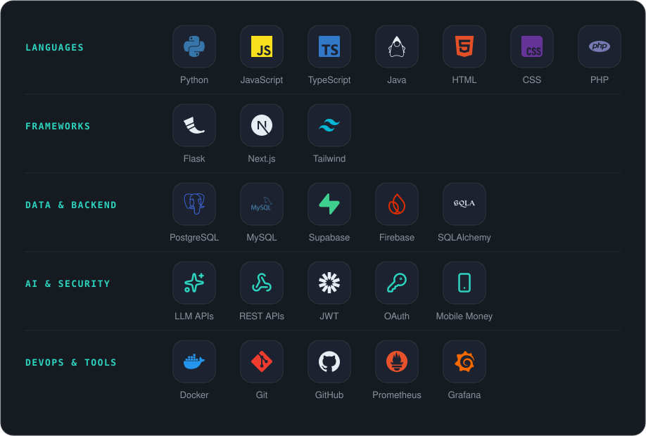
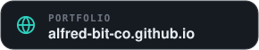

<!--
  Profile README — Alfred AYITOU (@Alfred-bit-co)
  • Visual assets live in /assets (dark + light variants, self-hosted → never break).
  • Stats cards in /profile and the contribution snake are regenerated daily by
    .github/workflows/profile.yml (no third-party service, no personal token needed).
-->

<a href="https://alfred-bit-co.github.io">
  <picture>
    <source media="(prefers-color-scheme: dark)" srcset="./assets/banner-dark.svg">
    <source media="(prefers-color-scheme: light)" srcset="./assets/banner-light.svg">
    
  </picture>
</a>

 

## About me

I'm a **Software Engineering student** and **freelance full-stack developer** from Togo 🇹🇬.
I take products from idea to deployment — and I'm especially interested in where **AI**, **security** and **real-world usability** meet.

- 🎓 **Studying** — Software Engineering (Licence 3) at UCAO-UUT, Lomé, with a focus on application development and systems security
- 🛠️ **Building** — full-stack web applications with Flask, Next.js and PostgreSQL, shipped for real clients
- 🔐 **Caring about** — secure authentication (JWT, OAuth), clean APIs and payment systems, including mobile money
- 🤖 **Exploring** — LLM integration and practical AI features inside everyday products
- 🎯 **Heading toward** — AI engineering: products with solid architecture, security and real users

  <b>SOFTWARE ENGINEERING</b> &nbsp;×&nbsp; <b>AI</b> &nbsp;×&nbsp; <b>SECURITY</b> &nbsp;×&nbsp; <b>REAL-WORLD PRODUCTS</b>

 

## Featured projects

  <a href="https://github.com/Alfred-bit-co/UCAO-marketplaceV1">
    <picture>
      <source media="(prefers-color-scheme: dark)" srcset="./assets/project-ucao-marketplace-dark.svg">
      <source media="(prefers-color-scheme: light)" srcset="./assets/project-ucao-marketplace-light.svg">
      
    </picture>
  </a>
  <a href="https://github.com/Alfred-bit-co/DataAnalys.AI">
    <picture>
      <source media="(prefers-color-scheme: dark)" srcset="./assets/project-dataanalys-ai-dark.svg">
      <source media="(prefers-color-scheme: light)" srcset="./assets/project-dataanalys-ai-light.svg">
      
    </picture>
  </a>
  <a href="https://github.com/Alfred-bit-co/Panier_Dor">
    <picture>
      <source media="(prefers-color-scheme: dark)" srcset="./assets/project-panier-dor-dark.svg">
      <source media="(prefers-color-scheme: light)" srcset="./assets/project-panier-dor-light.svg">
      
    </picture>
  </a>
  <a href="https://github.com/Alfred-bit-co/portfolio">
    <picture>
      <source media="(prefers-color-scheme: dark)" srcset="./assets/project-portfolio-dark.svg">
      <source media="(prefers-color-scheme: light)" srcset="./assets/project-portfolio-light.svg">
      
    </picture>
  </a>

 

## Tech stack

<picture>
  <source media="(prefers-color-scheme: dark)" srcset="./assets/stack-dark.svg">
  <source media="(prefers-color-scheme: light)" srcset="./assets/stack-light.svg">
  
</picture>

 

## GitHub activity

  <picture>
    <source media="(prefers-color-scheme: dark)" srcset="./profile/stats-dark.svg">
    <source media="(prefers-color-scheme: light)" srcset="./profile/stats-light.svg">
    
  </picture>
  <picture>
    <source media="(prefers-color-scheme: dark)" srcset="./profile/top-langs-dark.svg">
    <source media="(prefers-color-scheme: light)" srcset="./profile/top-langs-light.svg">
    
  </picture>

<picture>
  <source media="(prefers-color-scheme: dark)" srcset="https://raw.githubusercontent.com/Alfred-bit-co/Alfred-bit-co/output/snake-dark.svg">
  <source media="(prefers-color-scheme: light)" srcset="https://raw.githubusercontent.com/Alfred-bit-co/Alfred-bit-co/output/snake-light.svg">
  
</picture>

 

## Connect

  <a href="https://alfred-bit-co.github.io">
    <picture>
      <source media="(prefers-color-scheme: dark)" srcset="./assets/btn-portfolio-dark.svg">
      <source media="(prefers-color-scheme: light)" srcset="./assets/btn-portfolio-light.svg">
      
    </picture>
  </a>&nbsp;
  <a href="https://github.com/Alfred-bit-co">
    <picture>
      <source media="(prefers-color-scheme: dark)" srcset="./assets/btn-github-dark.svg">
      <source media="(prefers-color-scheme: light)" srcset="./assets/btn-github-light.svg">
      
    </picture>
  </a>&nbsp;
  <picture>
    <source media="(prefers-color-scheme: dark)" srcset="./assets/btn-location-dark.svg">
    <source media="(prefers-color-scheme: light)" srcset="./assets/btn-location-light.svg">
    
  </picture>

 

  <i>“Building software is not only about writing code. It's about turning problems into systems that people can actually use.”</i>

